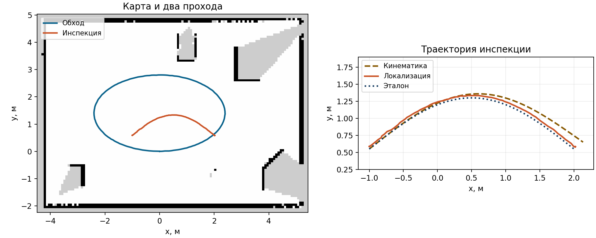

# МГТС · навигация инспекционного робота

По записи обхода алгоритм строит двумерную карту занятости. По отдельной записи инспекции он определяет положение робота на карте на каждой метке лидара. Обе записи обрабатываются офлайн на CPU.

**На синтетической инспекции среднеквадратичная ошибка положения составила 3,88 см по карте и 9,83 см по штатной одометрии.** Оба метода получили одинаковую стартовую позу и дали оценку на всех 100 сканах. [Воспроизвести демо](#проверить-за-один-запуск) · [Условия и метрики](docs/demo-results.md)



**Откуда взялись записи**

- **Синтетический офис.** Демогенератор проекта создаёт обход, инспекцию и эталонную траекторию. На этих записях получены ошибки положения, приведённые ниже. [Генератор](mgts_nav/demo.py)
- **Полевые сканы.** Открытая миссия GrandTour HEAP-1 лаборатории Robotic Systems Lab, ETH Zürich, записана 14 ноября 2024 года. Адаптер читает измерения лидара Velodyne VLP-16 из опубликованной версии миссии и сохраняет выбранные окна в ROS 2. [Ревизия данных](https://huggingface.co/datasets/leggedrobotics/grand_tour_dataset/tree/af6b6dd6f91696f8ec8c98134e195514834911b2/2024-11-14-13-45-37) · [Адаптер](https://github.com/Ivana-banana/MGTS/blob/9bab80b7b989289081e46c72066a9d08dd4d8efa/tools/heap1_sample.py) · [Команды воспроизведения](docs/public-data.md)
- **Intel Research Lab.** На открытой записи помещения в Сиэтле проверили плоский лазер и колёсную одометрию. С известной стартовой позой после сортировки меток локализованы 78 из 78 сканов. На четырёх общих метках среднеквадратичное расхождение с опубликованной SLAM-траекторией составило 0,235 м. Независимый эталон для этого окна отсутствует. [Источник и адаптер](docs/intel-lab.md) · [Условия сравнения](docs/intel-order-odom.md)
- **Записи финала МГТС.** Команда ожидает обход и инспекцию от организаторов. Подключение этих записей и проверка на них ведутся в [задаче №6](https://github.com/Ivana-banana/MGTS/issues/6).

[Короткий ответ для квалификационной формы](docs/qualification.txt) · [Первые 30 минут с данными финала](docs/intake.md) · [Как взять задачу](COORDINATION.md)

Рабочая очередь команды — GitHub Issues. Выберите открытую задачу без исполнителя, проверьте условия приёмки и назначьте её на себя. Метка `ready` выделяет подготовленные задачи; свободные задачи могут быть и без неё. После проверки опубликуйте изменения и укажите в issue коммит или PR, команду проверки и результат. [Свободные задачи](https://github.com/Ivana-banana/MGTS/issues?q=is%3Aissue%20is%3Aopen%20no%3Aassignee%20-label%3Aawaiting-data) · [Свободные с меткой ready](https://github.com/Ivana-banana/MGTS/issues?q=is%3Aissue%20is%3Aopen%20no%3Aassignee%20label%3Aready%20-label%3Aawaiting-data)

## Проверить за один запуск

Из корня MGTS в локальном Windows PowerShell один раз подготовьте окружение Python 3.10.

```powershell
py -3.10 -m venv .venv-mgts
& .\.venv-mgts\Scripts\python.exe -m pip install -r requirements.txt pytest
```

Для первого прогона и при открытии нового PowerShell активируйте окружение в текущем процессе. Команды ниже используют его интерпретатор.

```powershell
$env:Path = "$(Resolve-Path .venv-mgts\Scripts);$env:Path"
python -m mgts_nav.rehearse out/my-first-demo
```

Команда создаёт две записи ROS 2 с шумом, дрейфом и движущейся помехой, строит карту, проводит инспекцию и сравнивает два метода с известным эталоном. Для следующего запуска укажите новую выходную папку.

| Результат в папке прогона | Как использовать |
|---|---|
| `map/map.pgm`, `map/map.yaml` | Карта и её привязка. Чёрный — занято, белый — свободно, серый — неизвестно. |
| `map/route.png`, `inspection/route.png` | Маршрут поверх карты. Старт зелёный, финиш красный, участки только на прогнозе оранжевые. |
| `inspection/trajectory.csv`, `inspection/summary.json` | Поза в системе карты: время заголовка в секундах, x/y в метрах, yaw в радианах; статус сопоставления и итоговая поза. |
| `baseline/trajectory.csv`, `metrics.json` | Штатная одометрия с тем же стартом и сравнение с эталоном. |

На синтетической инспекции ошибка относительного перемещения между соседними сканами с интервалом 0,1 с составила 0,14 см у штатной одометрии и 0,66 см у локализации по карте. Эта метрика (RPE) показывает точность отдельного шага. Ошибка положения относительно эталона (ATE) учитывает и накопленный уход за предыдущие шаги.

## Подключить записи организаторов

Начните с двух отдельных профилей. Для каждой записи получите инвентарь и черновик с фактическими именами топиков и систем координат. На полной записи флаг `--verify-frames` проверяет также смену кадров внутри одного потока.

```powershell
python -m mgts_nav inspect data/mapping --inventory
python -m mgts_nav inspect data/inspection --inventory
python -m mgts_nav.profile data/mapping --verify-frames --out data/mapping.draft.json
python -m mgts_nav.profile data/inspection --verify-frames --out data/inspection.draft.json
```

Сохраните объект `profile` каждого черновика соответственно в `data/mapping.json` и `data/inspection.json`. Заполните неизвестные значения по калибровкам организаторов, проверьте единицы, интервалы покоя и направление трансформов из датчика в базу. Для `PointCloud2`, `Imu` и `Odometry` есть готовые адаптеры. Для пользовательского сообщения понадобится его схема. [Подключение датчиков](docs/sensors.md)

Перед запуском проверьте, на каких метках лидара доступны одометрия и IMU. [Как читать отчёт sync](docs/intake.md)

```powershell
python -m mgts_nav.sync data/mapping --config data/mapping.json
python -m mgts_nav.sync data/inspection --config data/inspection.json
python -m mgts_nav.solve data/mapping data/inspection --config data/mapping.json --inspection-config data/inspection.json --out out/official-01
```

По умолчанию старт определяется по геометрии первого скана. При неоднозначности алгоритм повторяет поиск по нескольким сканам с доступной кинематикой. В похожих коридорах флаг `--confirm-start` дополнительно проверяет принятую односкановую гипотезу по последующим наблюдениям. При наличии документированной стартовой позы передайте `--initial X Y YAW` или `--initial-file start.json`. Файл содержит массив из трёх чисел в системе карты: x и y в метрах, yaw в радианах. Решение сохраняет карту, траекторию и rosbag для RViz. При наличии кинематики строится также прогноз между сканами.

Если организаторы передадут эталон в системе карты, выполните `python -m mgts_nav.metrics out/official-01/inspection/trajectory.csv data/inspection_truth.csv`. При закрытом эталоне для защиты доступны доля сопоставленных сканов, длительность потерь и согласованность повторных проходов. [Шаблон отчёта](docs/report.md)

## Как устроен алгоритм

- **Время и прогноз.** Позы кинематики интерполируются на метки лидара. Относительное перемещение переносится в систему карты. Угловой прогноз берётся интегрированием гироскопа после оценки смещения на неподвижном начале. Исходная реализация предполагает горизонтальный пол и малые наклоны базы.
- **Коррекция позы.** После приведения облака в базу берём высотный срез и прореживаем его. ICP с отсечением дальних соответствий привязывает скан к недавним ключевым кадрам при обходе и к занятым ячейкам фиксированной карты при инспекции. Если совпадений мало, поза помечается `prediction_only` и такой скан не записывается в карту.
- **Карта.** Вдоль лучей накапливаются свидетельства свободного пространства, в концах — занятости. Повторные наблюдения помогают подавлять единичные отражения. Стекло, движение людей и длинные коридоры остаются отдельными проверочными сценариями.
- **Проверенные расширения.** Профиль поддерживает выравнивание облака по гравитации и компенсацию движения по меткам времени отдельных точек. Флаг `--close-loop` разрешает оптимизацию графа поз после проверки геометрии начала и конца обхода. Для камеры подготовлена оценка поворота по ректифицированным парам признаков. Схему сообщения и калибровку камеры нужно сверить с данными финала.

Для ускорения обновления ячеек в `map` и `solve` можно подключить ядро C++. Для топика ректифицированных изображений ROS модуль `image_pairs` извлекает пары признаков с метками времени камеры. [Сборка и запуск C++](docs/native-grid.md) · [Калибровка камеры и запуск image_pairs](docs/image-pairs.md)

Для обхода без кинематической одометрии в `map` и `solve` доступен экспериментальный флаг `--mapping-velocity-prior`. Две предыдущие подтверждённые позы дают прогноз перемещения для следующего скана. На 300 полевых сканах HEAP-1 ошибка конечной точки обхода снизилась с 62,70 до 24,67 см. На этой длинной карте автоматический старт `delayed` при повторной инспекции отказал в обоих режимах. [Условия эксперимента и команды](docs/heap1-velocity-prior.md)

На публичной записи HEAP-1 карта построена по 40 сканам. После ухода на 44,56 м робот вернулся в обследованную зону. При повторном посещении режим `--start-search delayed` определил старт по нескольким сканам без заданной позы и привязал все 60 сканов инспекции. На этом коротком участке среднеквадратичная ошибка относительно GNSS/INS CPT7 составила 4,82 см по положению и 0,416° по курсу. [Данные и калибровка](docs/public-data.md) · [Команда полного прогона и ограничения автостарта](docs/delayed-start.md)

Для защиты доступны [результаты при отказах датчиков](docs/demo-results.md), [замеры времени и памяти](docs/runtime.md) и [отчёт о посещении зон по подтверждённым участкам траектории](docs/zones.md). Проверенный коммит можно упаковать в ZIP с контролем SHA-256 по [инструкции для сдачи](docs/package.md).

Из Transport_MSK перенесены схема диагностики rosbag по времени заголовка, разделение ввода и алгоритма и сравнение с базовым методом на одинаковых записях. Модель движения учитывает боковое смещение робота. Источники требований — квалификационное задание в корне, слайды 5–9 профильного вебинара, расшифровка 21:37, 24:46 и 31:44–36:16. В вебинаре прозвучали разные ответы о доступности ground truth, поэтому предусмотрена оценка в обоих вариантах.

## Окружение команды

В обычном Windows PowerShell команда ниже показывает также причины пропуска отдельных тестов.

```powershell
& .\.venv-mgts\Scripts\python.exe -m pytest -q -rs
```

Для проверки C++ откройте Developer PowerShell x64 с доступным `cl.exe` в той же папке проекта и выполните `& .\.venv-mgts\Scripts\python.exe -m pytest -q tests/test_native_grid.py`. Тест сам собирает DLL во временном каталоге, запускает Python- и C++-варианты и сравнивает файлы результата. Полевой тест поиска по участкам карты использует локальные данные опыта №94 и пропускается, если они ещё не подготовлены. [Сборка C++](docs/native-grid.md) · [Полевые данные №94](https://github.com/Ivana-banana/MGTS/issues/94)

В шаблонах issue и PR фиксируем входную запись, команду воспроизведения и сравнение с базовым методом. Для Claude Code подключены персональный режим `/tests`, защита конфигов линтеров и ревью `silent-failure-hunter`. Хук использует Node.js из PATH и запускается из корня MGTS. Правила локальной работы описаны в [AGENTS.md](AGENTS.md). [Версия командного hackathon-kit](https://github.com/IR630/hackathon-kit/tree/09fe1a9ab8a65080b20f02abbce82ead066eb207)
