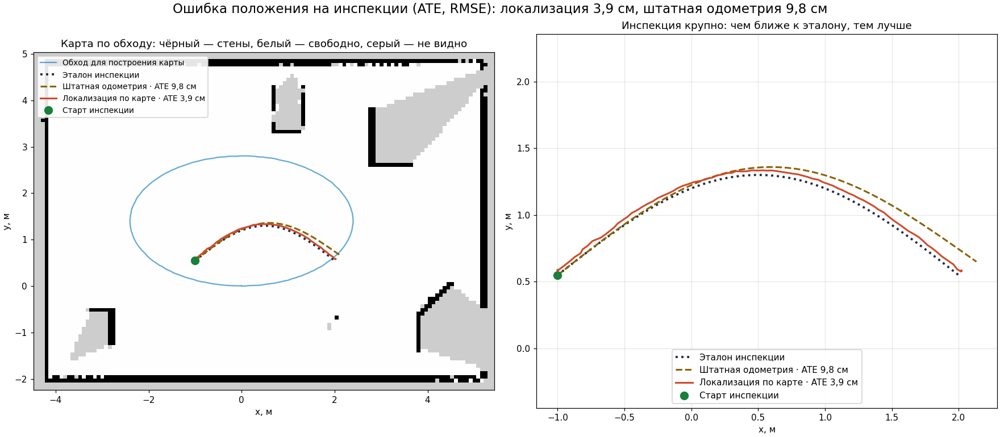

# Навигация на синтетической записи офиса

На десятисекундной инспекции с известной стартовой позой локализация по карте снизила среднеквадратичную ошибку положения с **9,83 до 3,88 см**. Обе оценки покрыли все 100 меток времени. На интервале 0,1 с кинематика точнее воспроизводила относительное движение. Для официальной записи результаты пока неизвестны.



Из корня MGTS запустите `.\.venv-mgts\Scripts\python.exe -X utf8 -m mgts_nav.rehearse out/my-first-demo` в новый каталог. Файл `comparison.png` воспроизводит рисунок выше по карте и четырём траекториям. Значения в легенде округлены до десятых долей сантиметра. Автор сравнения и текстовой сводки — [M1hairu, PR №19](https://github.com/Ivana-banana/MGTS/pull/19).

## Условия и результаты

Генератор моделирует плоский офис, шум дальности, пропуски отдельных лучей и движущийся цилиндр. Обход длится 20 с и включает 200 сканов. Отдельная инспекция длится 10 с и включает 100 сканов. Обход начинается в начале координат. Инспекция начинается в точке (−1,00 м, 0,55 м) с курсом 0,48 рад. Кинематика и локализация получили одинаковую стартовую позу. Эталонные CSV использованы для оценки.

| Запись и метод | ATE XY RMSE, см | RPE перемещения, см | RPE поворота, рад | Метки оценки / эталона |
|---|---:|---:|---:|---:|
| Обход · построение карты | 0,77 | 0,52 | 0,00139 | 200 / 200 |
| Инспекция · кинематика | 9,83 | 0,14 | 0,00063 | 100 / 100 |
| Инспекция · локализация | 3,88 | 0,66 | 0,00143 | 100 / 100 |

RPE рассчитана между соседними метками эталона, без дополнительного выравнивания. Положение на всём маршруте улучшилось примерно на 61 %, при этом результат относится к одной паре записей с фиксированными начальными условиями.

## Карта и движущаяся помеха

При размере клетки **8 см** и допуске **12 см** от центра занятой клетки до ближайшего известного статического отрезка в допуск попали **749 из 750** занятых клеток. Оставшаяся клетка расположена в полосе движения цилиндра. При определении этой полосы учтены радиус цилиндра и половина диагонали клетки. Принадлежность полосе показывает место артефакта, но не устанавливает причину его появления.

Построенная карта покрыла **89,35 %** из 44,19 м статических контуров. Длина учитывает также стороны препятствий, которые могли быть скрыты от лидара. Метрика измеряет долю длины, в пределах допуска от которой есть занятая клетка. Шаг выборки вдоль границ не превышает 4 см.

## Отказы на инспекции

Между 3-й и 5-й секундами отдельные копии записи теряли данные лидара или IMU. В сценарии дрейфа с 3-й секунды к координате x в системе кинематической одометрии добавлялась ошибка 0,30 м за каждую следующую секунду. Для каждого опыта использована одна и та же карта обычного обхода.

| Сценарий | ATE, см | Покрытие эталона | Сопоставлено среди выданных поз | Макс. серия prediction_only | Макс. разрыв поз, с |
|---|---:|---:|---:|---:|---:|
| Обычная инспекция | 3,88 | 100 % | 100 % | 0 | 0,1 |
| 20 пустых облаков | 3,99 | 100 % | 80 % | 20 | 0,1 |
| Пропали 20 сообщений лидара | 3,87 | 80 % | 100 % | 0 | 2,1 |
| Пропали 100 сообщений IMU | 3,89 | 100 % | 100 % | 0 | 0,1 |
| Дрейф кинематики | 4,01 | 100 % | 100 % | 0 | 0,1 |

При полном выпадении сообщений лидара текущий трекер молчит 2,1 с. ATE 3,87 см относится только к оставшимся 80 позам. Следующий эксперимент — выдавать прогноз по кинематике между сканами с явной пометкой источника. Проверять отдельно точность внутри пропуска, покрытие и ошибку первого сопоставления после восстановления.

## Воспроизведение

Запускайте из корня MGTS в окружении с зависимостями проекта. Каталоги вывода генератора и трекера должны быть новыми.

```powershell
python -m mgts_nav.demo out/repro/data
python -m mgts_nav map out/repro/data/mapping --config configs/example.json --out out/repro/map
python -m mgts_nav localize out/repro/data/inspection --config configs/example.json --map out/repro/map/map.yaml --initial-file out/repro/data/initial_pose.json --out out/repro/loc
python -m mgts_nav baseline out/repro/data/inspection --config configs/example.json --initial-file out/repro/data/initial_pose.json --out out/repro/base
python -m mgts_nav.metrics out/repro/map/trajectory.csv out/repro/data/mapping_truth.csv
python -m mgts_nav.metrics out/repro/loc/trajectory.csv out/repro/data/inspection_truth.csv
python -m mgts_nav.metrics out/repro/base/trajectory.csv out/repro/data/inspection_truth.csv
python -m mgts_nav.map_eval out/repro/map/map.yaml
python -m mgts_nav.stress out/repro/data --map out/repro/map/map.yaml
```

Для всех таблиц использован генератор с seeds 17 и 18 для обхода и инспекции соответственно. Версии прогона указаны первыми 12 знаками SHA-256 рабочих файлов.

| Компонент | SHA-256 | Компонент | SHA-256 |
|---|---|---|---|
| demo.py | 751AC683B60E | example.json | F93B0FC2C0B5 |
| bag.py | D0FE820A9108 | slam.py | DDDB4D6BF5DA |
| grid.py | C3DD48C008EA | metrics.py | C921B18F847A |
| stress.py | 403D18B07B0B | map_eval.py | 52386D11F728 |
| mapping_truth.csv | B69C29F73533 | inspection_truth.csv | 5A2FDE26999B |
| map.pgm | CD487BDF92AF | | |
