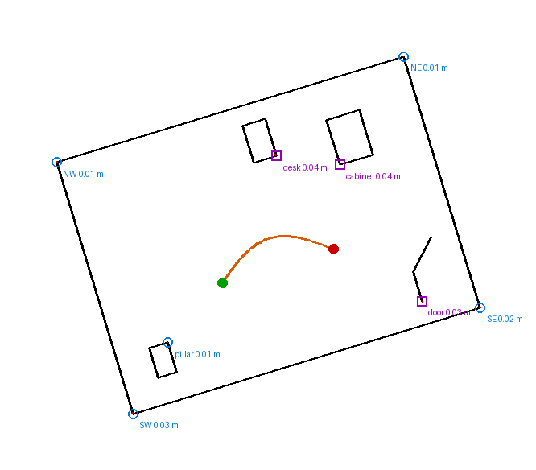

# Совмещение карты обхода со схемой объекта

`mgts_nav.floorplan` находит плоское преобразование между картой обхода и планом объекта по одноимённым контрольным точкам. При явно заданном режиме преобразование включает масштаб. Модуль не меняет фильтр локализации и не читает позы робота. Маршрут из `trajectory.csv` только переносится на план после подгонки.

## Вход

Один JSON-файл. Пути к изображению считаются от его папки.

```json
{
  "mode": "similarity",
  "plan": {"image": "plan.png", "y_axis": "down", "units": "px"},
  "map_points": {"NW": [-4.216, 4.774], "SW": [-4.205, -1.992], "door": [3.804, -1.435]},
  "plan_points": {"NW": [70.0, 201.9], "SW": [165.4, 514.1], "door": [524.2, 374.2]},
  "check": ["door"]
}
```

| Поле | Значение |
|---|---|
| `map_points` | Точки на карте `map.yaml` в метрах. Это система `map`, в которой пишутся `trajectory.csv`: X и Y как в ROS, ось Y повёрнута от X против часовой стрелки. |
| `plan_points` | Те же точки на плане в единицах плана. У пиксельного изображения начало — левый верхний угол, u вправо, v вниз; координаты берутся в пикселях исходного файла. |
| `plan.y_axis` | Обязательное. `"down"` для пикселей изображения, `"up"` для плана в метрах или в координатах САПР. Перед подгонкой ось Y при `"down"` переворачивается, чтобы обе системы были правыми. |
| `plan.units_per_meter` | Единиц плана в одном метре. Обязательно для `"rigid"`: например, 48 для растра 48 пикс/м или 1000 для плана в миллиметрах. |
| `mode` | `"rigid"` — поворот и сдвиг при известном масштабе плана. `"similarity"` — масштаб тоже оценивается; режим выбирается только явно. |
| `check` | Отложенные точки. В подгонку не входят, по ним считается ошибка на независимых точках. |

Имена точек сравниваются как строки. Если имя есть только на одной стороне, команда останавливается и перечисляет такие имена: это частая опечатка.

## Выход

`alignment.json` содержит `rotation_deg` — поворот от карты к плану в правой системе плана, `plan_units_per_map_meter`, `translation` — сдвиг в единицах плана с осью Y вверх, `fit_rms_m`, `check_rms_m` и `check_max_m`. Для каждой точки приводятся роль, предсказанная позиция на плане, ошибка в метрах карты и ошибка при исключении точки из подгонки, `leave_one_out_m`. Поле `warnings` перечисляет условия, при которых числам доверять нельзя. В `suspects` попадают точки, ошибка которых при исключении больше `--outlier` (по умолчанию четыре допуска `--tolerance`, то есть 0,2 м).

`overlay.png` — исходный план. Синими кругами отмечены точки подгонки, фиолетовыми квадратами — контрольные. Красный отрезок ведёт от отмеченной точки к предсказанной, рядом выводится ошибка в метрах. Если указан `--route`, оранжевая линия показывает маршрут: старт зелёный, финиш красный.

## Отказы и предупреждения

- Точки подгонки собраны в пределах удвоенного допуска выбора точки: отказ `Degenerate fit points`.
- Две точки определяют преобразование ровно, поэтому остатки равны нулю по построению. Команда предупреждает и об этом.
- Все точки на одной прямой: преобразование находится, но зеркальную ось плана обнаружить нельзя, выводится предупреждение.
- Зеркальное преобразование подходит гораздо лучше: отказ `check plan.y_axis`.
- Перепутаны координаты или имена двух точек: обе точки получают большую ошибку при исключении и попадают в `suspects`.

## Команды

Из корня MGTS в Windows PowerShell:

```powershell
python -m mgts_nav.floorplan points.json --route out/RUN/inspection/trajectory.csv --out out/plan
python -m mgts_nav.floorplan --synthetic out/plan-demo
```

Вторая команда рисует план демонстрационного офиса с известным поворотом 17°, масштабом 48 пикс/м и сдвигом. На карте восемь углов искажены шумом 0,02 м: пять входят в подгонку, три отложены. Эталон преобразования записан в `plan_truth.json`, подгонка его не читает. Маршрут на рисунке — аналитический путь синтетической инспекции, он только отрисовывается.

| Параметр | Задано | Найдено |
|---|---:|---:|
| Поворот, ° | 17,0 | 16,91 |
| Масштаб, пикс/м | 48,0 | 48,007 |
| Сдвиг u, пикс | 330,15 | 329,95 |
| Сдвиг v (Y вверх), пикс | −363,31 | −362,82 |
| RMS на точках подгонки, м | — | 0,018 |
| RMS / максимум на отложенных точках, м | — | 0,040 / 0,045 |



`tests/test_floorplan.py` проверяет точное восстановление без шума, режим `rigid` с неверно объявленным масштабом, вырожденные и коллинеарные точки, опечатку в имени, перестановку двух точек и ошибочное направление оси Y. Команды проверены на Linux, под Windows PowerShell не запускались.
