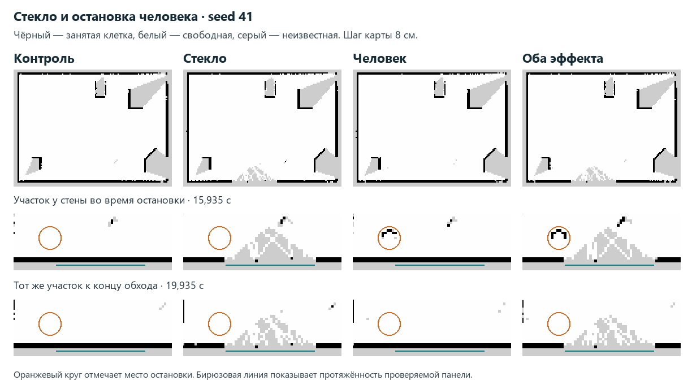

# Стеклянная панель и остановившийся человек

Восемь прогонов сравнивают четыре варианта одной геометрии на двух заранее заданных seed — 41 и 73. За основу взяты независимые записи обхода и инспекции офисного демо с известной статической геометрией. Начало инспекции задано одинаково во всех вариантах. На обоих маршрутах в модели стекла удаляются 99,5 % попаданий в участок нижней стены длиной 2,8 м (x от −1,4 до +1,4 м, y = −2 м). Проверка принадлежности учитывает шум дальности до 4,5 см от панели. Это модель потерь возврата. Прохождение луча через стекло и отражения от предметов за ним не моделируются.

Дополнительный человек представлен цилиндром радиусом 22 см. Во время обхода он проходит 1,2 м, стоит с 4-й по 16-ю секунду в точке (−1,60; −1,32) м и уходит обратно. Ближнее пересечение с цилиндром закрывает дальний возврат. Во второй записи этого человека нет. Исходная движущаяся помеха офисного демо присутствует во всех вариантах. Шум лидара и данные движения попарно совпадают внутри одного seed. Истинная поза используется при создании измерений и их оценке.

На стене расположены 70 контрольных точек с шагом 4 см. Если до ближайшей занятой клетки больше 12 см, точка считается пропуском. Ложные клетки на месте остановки считаются в радиусе 22 см плюс половина диагонали клетки, при удалении от любого статического сегмента более чем на 12 см. Разрешение карты 8 см.

| Seed | Вариант | Пропуски панели из 70 | Ложные клетки в конце остановки | Ложные клетки в конце обхода | ATE инспекции, см |
|---:|---|---:|---:|---:|---:|
| 41 | Контроль | 0 | 0 | 0 | 3,90 |
| 41 | Стекло | 56 | 0 | 0 | 3,82 |
| 41 | Человек | 0 | 7 | 0 | 3,82 |
| 41 | Оба | 62 | 10 | 0 | 3,67 |
| 73 | Контроль | 0 | 0 | 0 | 3,83 |
| 73 | Стекло | 36 | 0 | 0 | 3,66 |
| 73 | Человек | 0 | 6 | 0 | 3,86 |
| 73 | Оба | 40 | 9 | 0 | 3,56 |



В контрольных записях вся панель видна в пределах допуска. При потере возвратов пропали от 36 до 62 точек из 70. Пока человек стоял, в области остановки накопилось 6–10 ложных занятых клеток. На этих маршрутах последующие лучи прошли через освободившуюся область, и к концу обхода там осталось ноль занятых клеток. Во всех восьми инспекциях сопоставлены 100/100 сканов. На выбранном маршруте малая ошибка траектории сохраняется даже при существенном пробеле стены на карте.

## Воспроизведение

Из корня MGTS в Windows PowerShell, с новым выходным каталогом:

```powershell
$python = '.\.venv-mgts\Scripts\python.exe'
& $python -m mgts_nav.glass_experiment out/glass-person
& $python -m pytest -q tests/test_glass_experiment.py tests/test_map_eval.py
```

В каталоге каждого seed сохранены контрольные ROS 2 bags, изменённые записи, итоговые карты `map-*/map.yaml` и карты во время остановки `map-*/during-stop/map.yaml`. Общие числа приведены в `summary.json`.
