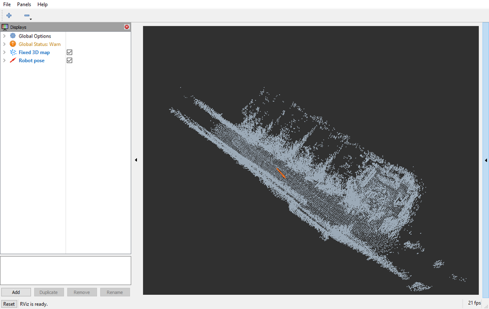

# Доставка карты Go2 в RViz

Узел mgts_nav.ros_localize3d публикует облако /mgts/map3d при запуске и один раз повторяет его при первой позе. Каждая рассчитанная поза публикуется в /mgts/pose3d. Кадр обоих сообщений — map.

| Топик | Тип | Издатель в коде | Запись, проигрывание и RViz в прилагаемом профиле |
|---|---|---|---|
| /mgts/map3d | sensor_msgs/msg/PointCloud2 | KEEP_LAST 1, TRANSIENT_LOCAL, стандартная надёжность издателя | KEEP_LAST 1, RELIABLE, TRANSIENT_LOCAL |
| /mgts/pose3d | geometry_msgs/msg/PoseStamped | стандартный профиль издателя, глубина 10 | KEEP_LAST 10, RELIABLE, VOLATILE |

Профиль [QoS rosbag2](../configs/go2-result-qos.yaml) задаёт политики по имени топика. При записи параметр относится к подписчику, при проигрывании — к издателю. [Профиль RViz](../configs/go2-result.rviz) задаёт их отдельно для облака и стрелки позы. Сохранённая копия карты доступна позднему подписчику, пока работает соответствующий издатель в том же домене DDS.

Из корня MGTS в активированном ROS 2 Humble запустите запись в новый каталог. Остальные выходные топики финального прогона можно добавить в эту же команду.

~~~~powershell
ros2 bag record -o out/issue199/recorded --qos-profile-overrides-path configs/go2-result-qos.yaml /mgts/map3d /mgts/pose3d /tf
~~~~

В двух терминалах проверьте настройки конечных точек во время записи. В выводе должны присутствовать узел локализации, подписки recorder, затем при воспроизведении — издатели player и подписки rviz. Историю и глубину некоторые реализации DDS возвращают как UNKNOWN.

~~~~powershell
ros2 topic info /mgts/map3d --verbose
ros2 topic info /mgts/pose3d --verbose
~~~~

## Две проверки воспроизведения

Используйте два запуска bag с начала. Завершите исходный узел локализации и запись перед воспроизведением, чтобы единственным источником карты был player. Для изолированной проверки можно задать одинаковый свободный ROS_DOMAIN_ID во всех терминалах.

1. До запуска player откройте RViz первой командой ниже. В отдельном терминале запустите проверку доставки, затем в третьем — команду воспроизведения. Дождитесь карты и движущейся стрелки.
2. Закройте первый RViz и завершите player. Запустите тот же bag с начала. Подождите минимум 10 с после первой позы и единственной сохранённой карты (или последней из двух начальных публикаций). Пока player проигрывает последующие позы, откройте новый RViz и запустите новый процесс проверки. Карта должна появиться без перемотки и перезапуска player.

~~~~powershell
rviz2 -d configs/go2-result.rviz
python -m tools.check_map_delivery --timeout 30
ros2 bag play out/issue199/recorded --qos-profile-overrides-path configs/go2-result-qos.yaml
~~~~

Проверка доставки возвращает 0 при непустом облаке в map и двух различающихся позициях с разными метками в этом кадре. В JSON выводятся число точек, число меток поз и обнаруженные издатели. Получение сообщений и состояние обоих Displays в графическом RViz фиксируются отдельно. Для демонстрации с текущим сканом из #198 имена топиков отличаются; этот профиль предназначен для выходов узла #182.

## Результат на официальной инспекции

Воспроизведён out/issue197/live-full/result на Windows с ROS 2 Humble и RViz 11.2.29. SHA-256 тома result_0.mcap — e79e4bf23ed03e1e9ea0a32b850fca66efed3b6783912f52eaebd4384711f2e1. В реальной записи 1 524 позы и два сообщения карты. Обе карты записаны в начале, в пределах первых 0,1 мс. В metadata.yaml поле offered_qos_profiles пустое у обоих топиков. При воспроизведении использован явный YAML выше.

В домене 72 у фактических mgts_localize3d и mgts_prefix_capture граф DDS показал RELIABLE / TRANSIENT_LOCAL для карты и RELIABLE / VOLATILE для поз. В домене 83 те же политики наблюдались у rosbag2_player и rviz при обоих порядках подключения. Граф вернул глубину 0, поэтому глубина 1 и 10 в таблице относится к конфигурации.

| Запуск RViz | Карта в новом подписчике | Движение |
|---|---:|---|
| За 8 с до старта player | 38 251 точка | Две разные позиции с разными метками, стрелка сдвинулась между кадрами RViz |
| Через 12 с после старта player | 38 251 точка | Две разные позиции с разными метками, стрелка сдвинулась между кадрами RViz |

Для нативного RoboStack на этой машине в PATH добавлен каталог Library/opt/rviz_ogre_vendor/bin из установленного окружения. RViz отображал предупреждение Global Status, а журнал OpenGL содержал GL_INVALID_OPERATION. На снимках видны облако и движение стрелки в обоих запусках.
