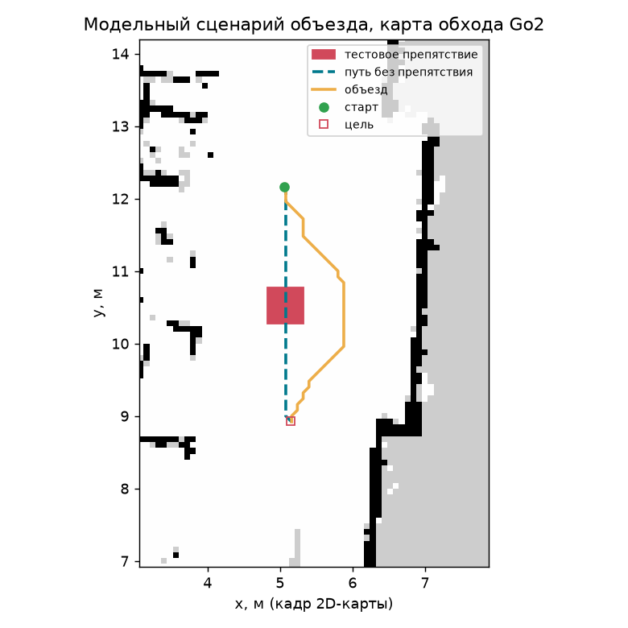

# Модельный сценарий: объезд препятствия на карте Go2 (#212)

**Модельный сценарий.** Препятствие задано вручную на реальном участке карты официального обхода. Робот его не наблюдал. Это проверка планирования пути, а не результат локализации и не автономное вождение. Официальный результат локализации описан в [комплекте финала](final-run/README.md).



## Сценарий

| Параметр | Значение |
|---|---|
| Карта | 2D-сетка официального обхода, клетка 0,08 м, PGM SHA-256 `219c86b8…` (совпадает с пересборкой в [#185](go2-independent-check.md)) |
| Неизвестные клетки | Непроходимы: путь идёт только по наблюдённой свободной области |
| Габарит Go2 | Корпус 0,70 × 0,31 м как описанный круг радиусом 0,38 м |
| Запас | 0,10 м; расчётный радиус 0,48 м от стен, неизвестных клеток и препятствия |
| Участок | Прямой коридор маршрута обхода, сканы 1350–1418; старт (5,059; 12,162), цель (5,148; 8,933) |
| Тестовое препятствие | Ящик 0,5 × 0,5 м, оси вдоль осей 2D-карты, центр (5,08; 10,52) — середина исходного пути |
| Контроль | Тот же ящик, растянутый поперёк коридора до 12 м |

Координаты даны в кадре 2D-карты (начало — первый скан обхода). `route.json` содержит те же линии и центр ящика в кадре 3D-карты прогона a5ad606, то есть в общем кадре одометрии: начало 2D-карты там находится в (1,038; 0,265) с курсом 0,4404 рад. В этом кадре ящик повёрнут на тот же угол.

**Выбор участка.** Старт и цель берутся на маршруте обхода в 4 м друг от друга по пути, причём по прямой между ними не меньше 3 м. Прямая должна держать расчётный радиус от стен и неизвестных клеток, а свободная ширина поперёк середины — быть не меньше 1,51 м. Из подходящих участков берётся самый просторный, у которого объезд не длиннее 1,5 исходного пути. Путь строит A* по 8 соседям на клетках, где расстояние до стены, неизвестной клетки или ящика не меньше расчётного радиуса.

## Результат

| Путь | Длина | Минимум до стен и неизвестных клеток | Минимум до ящика | Пересекает ящик |
|---|---:|---:|---:|---|
| Прямая старт — цель | 3,23 м | 1,11 м | 0 | да |
| Путь без препятствия | 3,31 м | 1,11 м | 0 | да |
| Объезд | 3,91 м | 0,96 м | 0,49 м | нет |
| Коридор перегорожен | — | — | — | планировщик отказал |

Все шесть проверок из `route.json` пройдены: исходный путь и прямая пересекают ящик, объезд найден, объезд держит расчётный радиус от стен, неизвестных клеток и ящика, перегороженный коридор отклонён. Клиренс проверяется по ломаной с шагом в четверть клетки, допуск — половина клетки (0,04 м). Поэтому 0,493 м до ящика засчитаны при радиусе 0,48 м.

## Воспроизведение

Из корня MGTS в PowerShell. Нужны 2D-карта и траектория обхода из штатного прогона.

```powershell
$py = '.\.venv-mgts\Scripts\python.exe'
& $py -X utf8 -m mgts_nav.solve data/official/mapping data/official/inspection --config configs/go2-official.json --map-cache out/issue185/go2-cache --initial 0.6885 -0.0885 0.3626 --out out/issue185/2d-odomstart
& $py -X utf8 -m tools.go2_obstacle_demo out/issue185/2d-odomstart/map/map.yaml out/issue185/2d-odomstart/map/trajectory.csv --mapping data/official/mapping --out out/go2-obstacle-demo
```

Команда пишет `out/go2-obstacle-demo/route.json` и `route.png` и завершается ошибкой, если хоть одна проверка не прошла. Копии результата лежат в [docs/go2-obstacle-demo.json](go2-obstacle-demo.json) и [docs/go2-obstacle-demo.png](go2-obstacle-demo.png). Логику проверяет `tests/test_go2_obstacle_demo.py` на синтетическом коридоре (3 passed): объезд вокруг ящика, отказ при перегороженном и слишком узком проходе.

## Формат route.json

- `routes.straight`, `routes.original`, `routes.detour`: `xy` — точки в кадре 2D-карты, `xy_map3d` — в кадре 3D-карты, `check` — длина, клиренсы и пересечение с ящиком.
- `obstacle`: центр и размер в кадре 2D-карты, `center_map3d` и `yaw_in_map3d_rad` — положение в кадре 3D-карты.
- `control_obstacle`: перегораживающий ящик и результат `refused`.
- `robot`, `map`, `segment`, `checks`: условия и итоги проверок.

## Ограничения

- Модель робота — круг. Корпус 0,70 × 0,31 м вписан в него при любом курсе, поэтому оценка консервативная. Кинематика шага и разворот на месте не моделируются.
- Путь — ломаная по центрам клеток 0,08 м без сглаживания. Для показа её можно сгладить, сохранив клиренс.
- Карта построена по одному обходу. Мелкие объекты ниже среза высот −0,15…+1,5 м и стекло могли не попасть в карту.
- Это не проверка автономного вождения: ни контроллер, ни реакция робота на реальное препятствие не проверялись.
