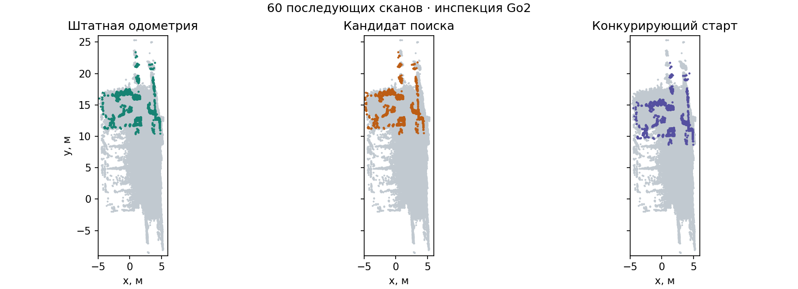

# Проверка старта инспекции Go2 на карте обхода

Для #184 на проверенной паре записей оставляем начальное `map ← odom` единичным. На окне 40,5 с глобальный поиск выделил область штатного старта. На следующих 60 сканах штатная поза дала меньший остаток, чем уточнённая. Окна длиной 2, 8, 12 и 20 с оставили неоднозначность. Абсолютная точность по этим данным неизвестна. Перенос единичного преобразования на новую запись требует отдельной проверки.

Первая пригодная метка лидара 1795605722,4492075 с. В этой точке позиция штатной одометрии в метрах (1,69891; 0,47793; 0,31314), кватернион xyzw (−0,02280; 0,00648; 0,39086; 0,92015). У самого первого из 1525 сканов отсутствует одометрия.

## Поиск и независимое окно

Сначала ограничиваем вход префиксом по времени доставки всех сообщений MCAP. После deskew собираем точки в odom инспекции, исключаем область пола, объединяем точки в вокселях 14 см. Сохраняем высоту, крен и тангаж из одометрии. По всей карте перебираем X от −5 до +6 м, Y от −9 до +26 м с шагом 0,5 м и поправку курса от −180° до +170° с шагом 10°. Уточняем до 24 разнесённых начальных гипотез, включая штатную, в окрестности ±0,65 м и ±14°. Оценка — среднее расстояние до карты с ограничением 0,5 м. Отдельным соперником считаем гипотезу дальше 0,8 м или 25°.

После фиксации кандидата пропускаем ещё 2 с по меткам заголовка и проверяем 60 новых сканов. Рабочий порог отрыва 2 см требуется и на префиксе, и на контроле. Порог разведочный, независимой калибровки вероятности ошибки нет. Если штатная одометрия в том же районе и дала меньший контрольный остаток, сохраняем штатный старт. Проверка офлайн, все варианты используют одну физическую инспекцию.

| Префикс, с | Использовано сканов | Поиск, с | Кандидат / соперник на префиксе, м | Кандидат / соперник / штатная на контроле, м | Решение |
|---:|---:|---:|---|---|---|
| 2 | 27 | 3,8 | 0,076 / 0,076 | 0,127 / 0,200 / 0,131 | отказ |
| 8 | 109 | 8,5 | 0,107 / 0,108 | 0,218 / 0,155 / 0,148 | отказ |
| 12 | 165 | 19,1 | 0,135 / 0,146 | 0,135 / 0,148 / 0,139 | отказ |
| 20 | 277 | 29,0 | 0,135 / 0,152 | 0,124 / 0,142 / 0,145 | отказ |
| 40,5 | 562 | 53,9 | 0,148 / 0,172 | 0,156 / 0,220 / 0,141 | оставить штатную |

На восьми секундах победил кандидат примерно в девяти метрах от штатного старта. Контрольное окно выявило ухудшение. На 40,5 с кандидат дал `map ← odom` с переносом (−0,268; 0,011; 0) м и углом +0,01179 рад. Преимущество штатной одометрии на контроле составило 1,45 см, поэтому эту поправку применять не следует. Конец контрольного окна — 1795605769,0486093 с по заголовку, примерно 46,68 с после первого лидара. Время вычисления указано отдельно, по одному запуску на общей Windows-машине. Метод применяется для проверки стартовой гипотезы офлайн.



## Воспроизведение

```powershell
python -m mgts_nav.localize3d data/official/mapping data/official/inspection --out out/start-map
python -m tools.bag_delivery_prefix data/official/inspection out/start-prefix --duration-ns 40500000000
python -m tools.go2_start_search out/start-map/map.npz out/start-prefix data/official/inspection
python -m pytest -q tests/test_go2_start_search.py
```

Используйте новые выходные каталоги. Для коротких окон замените длительность в наносекундах. Синтетический контроль восстанавливает известные перенос и поворот 40°. При точном повторении той же геометрии со сдвигом на 6 м инструмент находит обе равнозначные гипотезы. В опубликованный трекер изменения не вносились.
