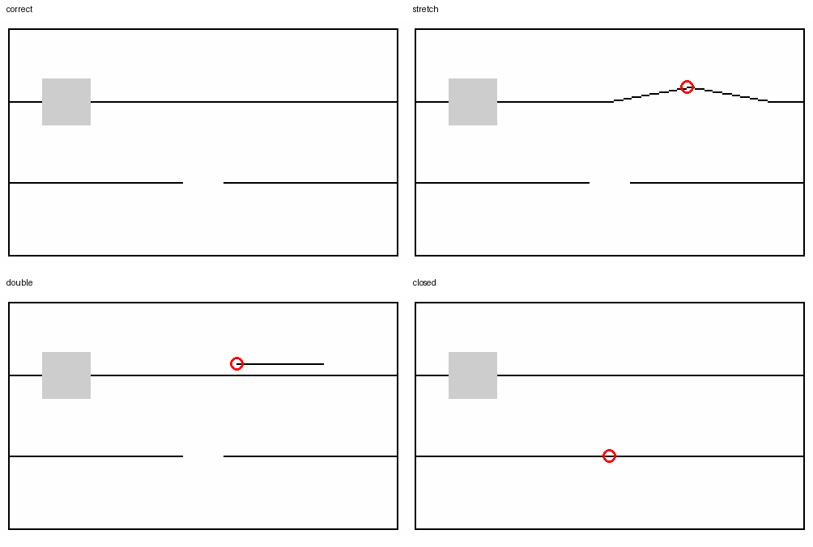

# Геометрия карты по отложенным стенам и дверному проёму

В контрольном синтетическом офисе с двумя параллельными внутренними стенами масштаб задан (0,04 м/клетку). Три наружных угла задают одно жёсткое преобразование между сеткой и планом. При проверке по внутренним стенам и проёму преобразование фиксировано. Поперечные сечения с неизвестными клетками исключены из метрической оценки и учтены в покрытии. Для двойной стены учитываются обе поверхности. Ширина проёма измеряется между центрами клеток косяков; положение центра проёма задано планом.

| Карта | Максимальное отклонение стены, м | P95, м | Максимальная ошибка расстояния стен коридора, м | Ширина проёма, м | Ошибка ширины, м |
|---|---:|---:|---:|---:|---:|
| Правильная | 0 | 0 | 0 | 1,04 | 0 |
| Локальное растяжение | 0,36 | 0,28 | 0,36 | 1,04 | 0 |
| Двойная стена | 0,28 | 0,28 | 0,28 | 1,04 | 0 |
| Закрытый на карте проём | 0 | 0 | 0 | 0 | 1,04 |

Во всех четырёх случаях покрытие сечений стен 92,1% (350/380), 30 сечений без обзора. Центр проёма наблюдался во всех случаях, поэтому закрытие противоречит плану. Красный круг показывает одно из мест максимальной ошибки. Серый участок исключён из оценки.



Без плана доступна только доля наблюдаемых клеток растра (97,70%). Ошибки относительно разметки отсутствуют в выводе. Контроли проверяют измеритель на аналитической геометрии. Для реального плана в №6 нужны масштаб, точность контрольных размеров и независимые от привязки ориентиры. На данной сетке разрешение ограничивает измерение одним шагом 0,04 м, а нулевые значения получены для совпадающих растров.

```powershell
& .\.venv-mgts\Scripts\python.exe -m tools.heldout_floorplan out/issue179-repeat
```

Команда сохраняет scores.json и geometry.png, проверяет исходную карту и обнаружение трёх заданных дефектов.
