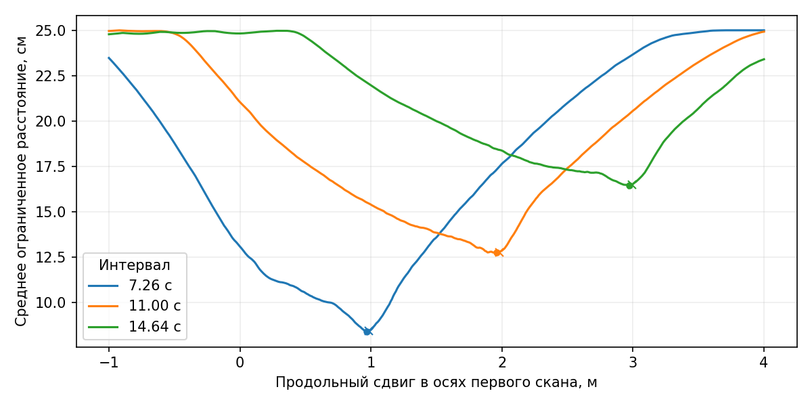

# Продольное движение на трёх парах сканов Intel Lab

При поперечном сдвиге и повороте из внешнего RBPF геометрия исходных лучей на всех трёх парах лучше согласуется с движением вперёд, чем с нулевым продольным сдвигом. Минимумы на сетке отличаются от продольной компоненты RBPF на 1,5–2,1 см. Это условная проверка одной координаты. RBPF использовал тот же лазер. [Предварительный протокол](https://github.com/Ivana-banana/MGTS/issues/111#issuecomment-7149144497) · [Сравнение треков №110](intel-relative-motion.md)

| Интервал, с | Концы лучей, первый / текущий | Продольный сдвиг RBPF / минимум, м | Ошибка при нуле / RBPF / минимуме, см | Взаимные пары при нуле / RBPF / минимуме | Диапазон в 1 см от минимальной оценки, м |
|---:|---:|---:|---:|---:|---:|
| 7,257 | 165 / 162 | 0,985 / 0,97 | 13,07 / 8,41 / 8,37 | 85 / 77 / 79 | 0,82–1,09 |
| 10,999 | 165 / 161 | 1,981 / 1,96 | 21,04 / 12,76 / 12,73 | 52 / 41 / 41 | 1,55–2,08 |
| 14,645 | 165 / 155 | 2,990 / 2,97 | 24,83 / 16,49 / 16,46 | 3 / 23 / 23 | 2,38–3,11 |



Крестик обозначает сдвиг RBPF, кружок — минимум сетки. Для последней пары минимум находится около 3 м, но диапазон почти равных оценок имеет ширину 73 см. Поддержка по взаимным ближайшим соседям в минимуме падает с 79 пар до 23 по мере удаления от первого скана. Поэтому численная близость минимумов к RBPF не устанавливает сантиметровую точность положения.

**Метод.** Четыре точные метки из №110 найдены в исходном журнале FLASER. Использованы три пары от одного первого скана. Концы лучей с дальностью строго между 0 и 20 м переведены из текущей системы координат в систему первого скана. Продольное смещение перебиралось от −1 до +4 м с шагом 1 см. Для каждого положения вычислялось среднее двух направленных средних расстояний до ближайшего конца луча. Вклад каждого расстояния ограничен 25 см. Оценка при точном сдвиге RBPF вычислялась отдельно от сетки. Число взаимных ближайших соседей на расстоянии до 25 см характеризует перекрытие; принадлежность концов лучей одной физической точке неизвестна.

Синтетический контроль с поворотом 90° и ненулевым переносом проверил направление преобразования. Для последней полевой пары независимый расчёт полной матрицы расстояний воспроизвёл все три оценки с расхождением менее 0,000001 см. Выбор этих трёх интервалов, фиксированные компоненты RBPF и ограничение расстояний определяют область вывода. Эксперимент не устанавливает причину дрейфа последовательного ICP и не оценивает совместную наблюдаемость всех трёх координат.

```powershell
& .\.venv-mgts\Scripts\python.exe -m pytest -q tests/test_intel_longitudinal.py
& .\.venv-mgts\Scripts\python.exe -m tools.intel_longitudinal out/intel107/intel.log.gz out/intel107/data-repeat/inspection-external.csv out/intel111-repeat
```

Для графика нужен Matplotlib. Инструмент сохраняет полный профиль в CSV и график в PNG в новом выходном каталоге. Исходная запись и внешний CSV готовятся по [инструкции №107](intel-lab.md).
