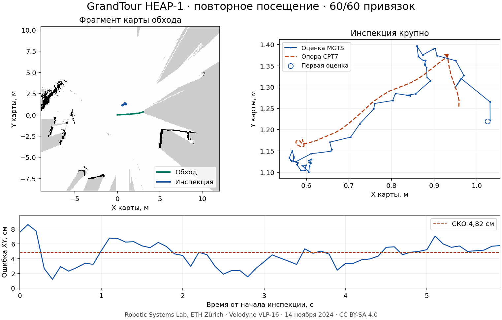

# Независимая запись для проверки локализации

Для первого реального прогона выбран **GrandTour, Heap Testsite 1 (HEAP-1)**. Это валидационная миссия ANYmal-D из коллекции Robotic Systems Lab, ETH Zürich. На двух отрезках одного полевого маршрута проверены чтение датчиков, построение карты и локализация при повторном посещении. Записи организаторов ожидаются в [№6](https://github.com/Ivana-banana/MGTS/issues/6). [Миссия в списке COMFORT](https://grand-tour.leggedrobotics.com/tasks/localization)

Данные распространяются под CC BY-SA 4.0. При распространении производных данных укажите авторов, источник, лицензию и внесённые изменения и примените ту же лицензию. Карточка набора приводит библиографическую запись работы Frey и др. о Boxi (RSS 2025). [Лицензия на сайте проекта](https://grand-tour.leggedrobotics.com/) · [Карточка и цитирование](https://huggingface.co/datasets/leggedrobotics/grand_tour_dataset)

## Что получилось на открытой записи



Карта построена по кадрам Velodyne 150–189. После возвращения робота режим `--start-search delayed` определил начало инспекции по сканам, и все 60 меток кадров 2560–2619 получили привязку. Опора CPT7 использована для последующего сравнения. Среднеквадратичная ошибка XY за 5,9 с составила 4,82 см. На карте белые клетки свободны, чёрные заняты, серые остались неизвестными. [Запуск полного решения](delayed-start.md)

Источник рисунка — полевые измерения Robotic Systems Lab, ETH Zürich. MGTS преобразовал XYZ и IMU в ROS 2 bag, построил карту, оценил маршрут и наложил опорную траекторию. Производный рисунок распространяется под CC BY-SA 4.0. [Файлы миссии от 14 ноября 2024 года](https://huggingface.co/datasets/leggedrobotics/grand_tour_dataset/tree/af6b6dd6f91696f8ec8c98134e195514834911b2/2024-11-14-13-45-37) · [Лицензия](https://creativecommons.org/licenses/by-sa/4.0/)

```powershell
python -m tools.plot_heap1_revisit out/heap1-blind-solve out/heap1-revisit-v2/inspection-reference.csv out/heap1-field.png
```

## Подключение

1. В каталоге GrandTour выбрать HEAP-1. ROS 1 bags выдаются через Kleinkram после регистрации. Открытая копия Zarr доступна через Hugging Face и требует отдельного преобразования в сообщения ROS. [Форматы и порядок доступа](https://grand-tour.leggedrobotics.com/dataset)
2. Для одной миссии взять потоки Hesai, ADIS, одометрию ANYmal и статические трансформации. Ожидаемые имена перечислены ниже. Инспектор принимает путь к одному bag. Для одного прогона навигации объединить потоки по времени в одной записи, сохранив исходные заголовки, типы сообщений и времена измерений. [Профиль GrandTour в MOLA](https://docs.mola-slam.org/latest/datasets/grandtour.html)

| Файл миссии | Ожидаемый топик | Назначение |
|---|---|---|
| `*_hesai.bag` | `/boxi/hesai/points` | Облако точек |
| `*_adis.bag` | `/boxi/adis/imu` | Угловая скорость |
| `*_anymal_state.bag` | `/anymal/state_estimator/odometry` | Бортовая оценка движения |
| `*_tf_minimal.bag` | `/tf_static` | Калибровка относительно корпуса |

3. Запустить `python -m mgts_nav inspect PATH_TO_BAG` для каждого файла. Сверить частоты, frame_id, времена, разрывы, поля облака и типы. Для объединённой записи подставить в профиль MGTS фактические топики, кадр корпуса, родительский кадр одометрии и цепочки IMU/LiDAR → корпус из калибровки. Проверить, есть ли неподвижный интервал для оценки смещения гироскопа.
4. Для сравнения с эталоном COMFORT привести точки траектории к раме призмы через калибровку, согласовать время и общую систему отсчёта. Отдельно оценить пригодность плоской модели на наклонных участках. [Требования к системе координат](https://grand-tour.leggedrobotics.com/tasks/localization)

## Реальный фрагмент HEAP-1

Проверка 25 ноября 2026 года выполнена на Velodyne VLP-16 миссии 24, **Heap Testsite 1**, 14 ноября 2024 года. Из локального Windows PowerShell доступны метаданные и содержимое открытых Zarr-архивов. UUID миссии — `512edee1-de86-463f-bdda-f55362e2fda1`. Данные предоставлены Robotic Systems Lab, ETH Zürich. [Каталог миссий](https://grand-tour.leggedrobotics.com/data/missions.json) · [Файлы миссии в проверенной ревизии](https://huggingface.co/datasets/leggedrobotics/grand_tour_dataset/tree/af6b6dd6f91696f8ec8c98134e195514834911b2/2024-11-14-13-45-37)

Адаптер `tools/heap1_sample.py` из исходного репозитория запрашивает три диапазона архива Velodyne по HTTP (суммарно 91 065 893 байта), проверяет SHA-256 и декодирует блоки Blosc. Из них выбираются кадры 300–359, XYZ до счётчика `valid` каждой строки и времена из `timestamp`. Первые 40 облаков записываются в ROS 2 bag обхода, следующие 20 — в отдельный bag инспекции. Оба окна принадлежат одному непрерывному проходу. Метаданные задают статическое преобразование из `velodyne_lidar` в корпус `base`. В этом опыте работают только XYZ, без IMU, одометрии и коррекции движения внутри оборота. Экспериментальный срез по высоте относительно корпуса — 0,15–1,50 м.

### Воспроизведение из корня MGTS в PowerShell

Для конвертера нужен дополнительный пакет numcodecs. Команды рассчитаны на новые выходные каталоги. Копии исходных данных и результаты остаются в `out/`.

```powershell
$python = '.\.venv-mgts\Scripts\python.exe'
& $python -m pip install numcodecs==0.13.1
& $python tools/heap1_sample.py out/heap1-sample
& $python -m mgts_nav inspect out/heap1-sample/mapping
& $python -m mgts_nav inspect out/heap1-sample/inspection
& $python -m mgts_nav map out/heap1-sample/mapping --config out/heap1-sample/profile.json --out out/heap1-map
& $python -m mgts_nav localize out/heap1-sample/inspection --map out/heap1-map/map.yaml --config out/heap1-sample/profile.json --out out/heap1-auto
$seed = (Get-Content out/heap1-map/summary.json -Raw | ConvertFrom-Json).final_pose
& $python -m mgts_nav localize out/heap1-sample/inspection --map out/heap1-map/map.yaml --config out/heap1-sample/profile.json --initial @seed --out out/heap1-localized
```

Первое окно охватывает 3,900 с, второе 1,900 с, интервал между окнами 0,100 с. В обоих медианная частота 10,05 Гц, максимальный разрыв 0,101 с, повторов и обратного хода времени не обнаружено.

| Проверка | Результат |
|---|---|
| Построение карты | Первая поза задала начало координат, 39 из 39 следующих сканов сопоставлены. Карта 817 × 787 клеток по 8 см, 2508 занятых клеток. |
| Автоматический поиск на начале второго окна | Отказ с кодом 2. Первый скан набрал недостаточную поддержку, для многосканового поиска размер карты превысил установленный вычислительный лимит. |
| Продолжение с последней оценённой позы первого окна | 20 из 20 новых сканов сопоставлены с фиксированной картой, медианная доля точек, согласованных с картой, — 59,7 %. В CSV сохранены все 20 поз. |

Эталон к этой оценке не привлекался. Доля согласованных точек характеризует поддержку привязки и не измеряет ошибку положения. Опыт проверяет перенос локализатора на короткий реальный отрезок с известной предыдущей позой. Для оценки точности и способности вернуться в ранее обследованную зону нужен повторный проход с согласованным эталоном.

## Повторное посещение после ухода на 44,56 м

На той же миссии HEAP-1 проверены два неперекрывающихся окна Velodyne. Обход — кадры 150–189, время 1731588427,081529–1731588430,981913 с. Инспекция — кадры 2560–2619, время 1731588668,081259–1731588673,981606 с. Траектория корпуса по независимому GNSS/INS CPT7 показывает удаление от начала обхода на 44,56 м. При возвращении все 60 точек инспекции находятся в пределах 1,37 м по XY от линии обхода (расстояние до ближайшего отсчёта). На этом отрезке робот прошёл всего 0,62 м и повернулся примерно на 38°. [Исходные потоки миссии](https://huggingface.co/datasets/leggedrobotics/grand_tour_dataset/tree/af6b6dd6f91696f8ec8c98134e195514834911b2/2024-11-14-13-45-37/data)

Карта и локализатор используют Velodyne и гироскоп ANYmal. Оси обоих датчиков приведены к корпусу по опубликованным статическим преобразованиям. Времена IMU охватывают все 39 и 59 межскановых интервалов, максимальный разрыв 2,89 и 3,21 мс соответственно. На инспекции интеграл скорости поворота вокруг оси Z корпуса составил 0,668 рад, изменение курса CPT7 — 0,664 рад. На обходе — 0,125 и 0,125 рад. Поправки часов и оценка смещения гироскопа на интервале покоя выключены. У опубликованного потока кинематической одометрии в Zarr указан родительский кадр `odom`, дочерний кадр в атрибутах отсутствует, поэтому он исключён из обоих вариантов. [Калибровки миссии](https://huggingface.co/datasets/leggedrobotics/grand_tour_dataset/blob/af6b6dd6f91696f8ec8c98134e195514834911b2/2024-11-14-13-45-37/metadata/tf.yaml)

Для независимого сравнения адаптер сверяет позы CPT7 в ENU с обратным преобразованием из потока TF на совпадающих временах. Затем переводит положение CPT7 к началу корпуса по цепочке `base ← box_base ← cpt7_imu`. Положение первой позы обхода и её курс задают общую плоскую систему координат. Координаты в моменты сканов интерполированы линейно, вращения — сферической интерполяцией. Подгонки к оценённой траектории нет. В режиме с известным стартом используется только первая поза инспекции из этой опоры. ATE показывает согласие с решением GNSS/INS в данной системе координат.

| Режим | Сопоставления | Отказы при старте | Ложные старты | ATE XY RMSE |
|---|---:|---:|---:|---:|
| Обход | 39/39 после первой позы | — | — | 8,03 см |
| Инспекция, автоматический старт | траектория отсутствует | 1 | 0 принятых | — |
| Та же инспекция, известный старт | 60/60 | 0 | неприменимо | 4,75 см |

На автоматическом старте поддержка первого скана оказалась недостаточной, а карта превысила лимит многосканового поиска. При известном старте медианная доля точек, согласованных с картой, составила 59,5 %. Опыт охватывает одно повторное посещение и одну попытку автоматического старта.

### Команды для повторного посещения

Запустить в том же окружении с `numcodecs`, что и предыдущую проверку. Для автостарта ожидается диагностический выход с кодом 2. Сравнение обоих режимов использует одну карту и один bag инспекции.

```powershell
$python = '..\Transport_MSK\.venv\Scripts\python.exe'
& $python tools/heap1_revisit.py out/heap1-revisit-v2
$data = 'out/heap1-revisit-v2'
& $python -m mgts_nav map "$data/mapping" --config "$data/profile.json" --out out/heap1-revisit-map
& $python -m mgts_nav localize "$data/inspection" --map out/heap1-revisit-map/map.yaml --config "$data/profile.json" --out out/heap1-revisit-auto-v2
$p = Import-Csv "$data/inspection-reference.csv" | Select-Object -First 1
& $python -m mgts_nav localize "$data/inspection" --map out/heap1-revisit-map/map.yaml --config "$data/profile.json" --initial $p.x $p.y $p.yaw --out out/heap1-revisit-seeded-v2
& $python -m mgts_nav.metrics out/heap1-revisit-seeded-v2/trajectory.csv "$data/inspection-reference.csv"
```
