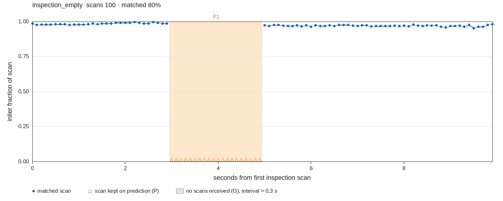
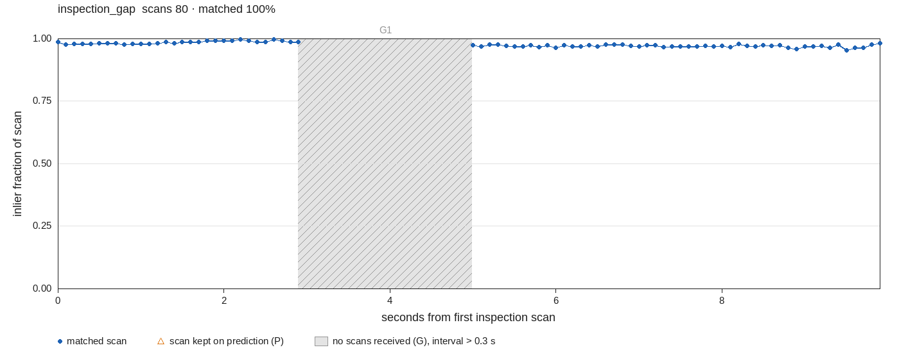

# Отчёт по навигации инспекционного робота

Запись и версия данных — […]. Версия решения и конфигурация — […]. Начальная поза инспекции и источник её определения — […]. Укажите длительность обхода и инспекции, используемые сенсоры и систему координат.

## Карта и маршрут

Приложите карту обхода с масштабом, началом координат и направлением осей. На отдельном рисунке нанесите инспекционный маршрут, отметьте участки потери локализации и покажите совпадение повторно пройденных участков.

## Точность при доступном эталоне

Обе оценки должны использовать один эталон, одну систему координат и одинаковый порог пропусков. Заполните строку для каждого метода на каждой записи. Синтетические и реальные записи укажите отдельно.

| Запись и метод | ATE XY RMSE, м | RPE перемещения, м | RPE поворота, рад | Покрытие | Число пар RPE |
|---|---:|---:|---:|---:|---:|
| […] · штатная одометрия | | | | | |
| […] · наше решение | | | | | |

`python -m mgts_nav.metrics estimate.csv truth.csv` оценивает позы на временных метках эталона. Координаты интерполируются линейно, угол — по кратчайшей дуге. ATE считается в общей системе без дополнительного выравнивания. Для RPE сравниваются приращения между соседними метками эталона в системе робота в начале интервала. Укажите частоту эталона. Покрытие — доля эталонных меток, на которые получена оценка. Выход за границы записи и интерполяция через разрыв исключаются. По умолчанию порог разрыва равен трём медианным интервалам соответствующего ряда. Для общего фиксированного порога передайте `--max-gap-s N`. Значение JSON `null` означает, что для метрики нет подходящих точек или пар.

## Если эталон закрыт

В `inspection/summary.json` раздел `quality` содержит долю принятых сканов и медианную долю точек ближе 0,16 м к карте среди принятых сканов. В `prediction_runs` у каждого участка указаны число сканов на прогнозе, первая и последняя их метки, а также соседние подтверждённые позы по времени. Пустая граница означает начало или конец записи. Поле `scan_gaps` содержит интервалы между полученными сканами длиннее трёх медианных периодов. Порог выводится в секундах. Эти показатели помогут выбрать участок для просмотра в RViz. Повторяющаяся геометрия коридора может давать высокое совпадение и при неверной позе.

### График потерь локализации по времени

`python -m mgts_nav.timeline out/RUN/inspection` читает `trajectory.csv` из `localize` или `solve` и сохраняет рядом `timeline.png` и `timeline.intervals.csv`. Эталон и данные о реальном маршруте не нужны. По горизонтали — секунды от первого скана инспекции, по вертикали — доля точек скана ближе 0,16 м к карте (`inlier_fraction`, шкала 0–1). Синие точки — принятые сканы. Линия соединяет только соседние принятые сканы без разрыва между ними. Оранжевые треугольники на оранжевой полосе `P1`, `P2`… — полученные сканы, оставленные на прогнозе. Серая штриховка `G1`, `G2`… — интервал без сканов длиннее порога `gap_threshold_s`, по умолчанию три медианных периода. Порог и участки совпадают с `quality` в `summary.json`, потому что считаются той же функцией по всей записи. Если сканов меньше трёх, период не определён: точки рисуются без соединительной линии. Для короткой записи, где медиана не отражает частоту лидара, порог задаётся явно: `--gap-s 0.3`.

`timeline.intervals.csv` перечисляет участки: метка, тип (`prediction_run` или `scan_gap`), начало и конец в секундах от первого скана и в исходном времени, число сканов и номера строк `first_line`–`last_line` в `trajectory.csv`. Номер строки считается с единицы, первая строка — заголовок. У разрыва указаны строки двух сканов, которые его ограничивают. Чтобы рассмотреть участок крупнее, задайте окно в секундах от первого скана: `--from 2.5 --to 5.5`. Без `--out` окно сохраняется в `timeline-2.5-5.5.png` и не затирает общий график. Время на оси, метки `P`/`G` и порог разрыва остаются такими же, как на графике всей записи. Участок, обрезанный границей окна, помечен звёздочкой, а в таблице — `clipped=True`. В заголовке выводятся номера строк окна. `--out` задаёт путь PNG, таблица сохраняется рядом как `<имя>.intervals.csv`. Команда отказывается писать поверх входного CSV. Файл, пересохранённый в Excel или PowerShell с BOM или разделителем `;`, тоже читается. На один скан график строится.

Пример для защиты собирается одной командой из корня MGTS в Windows PowerShell:

```powershell
python -m mgts_nav.timeline --demo out/timeline-demo
```

Команда генерирует синтетические записи, строит карту и локализует три варианта одной инспекции: без изменений, с удалёнными сообщениями лидара на 3–5 с и с пустыми сообщениями лидара на тех же секундах. В `inspection/`, `inspection_gap/` и `inspection_empty/` сохраняются `timeline.png` и `timeline.intervals.csv`. Последний вариант даёт участок `P1` из 20 сканов на прогнозе, строки 32–51; вариант с удалёнными сообщениями — разрыв `G1` 2,1 с между строками 31 и 32. Прогон занимает несколько секунд. Команды проверены на Linux, под Windows PowerShell не запускались.





Отметьте, какие метрики смогут посчитать организаторы, и приложите траекторию в CSV с единицами и системой координат. На финальной записи приведите проверяемые наблюдения: длительность участков потери локализации, расхождение при повторном посещении известной точки и наложение инспекционных сканов на карту обхода. Для каждого числа укажите способ измерения. Такие наблюдения характеризуют согласованность решения и сами по себе не измеряют абсолютную точность.

## Воспроизводимость и ограничения

Команда запуска — […]. Конфигурация и железо — […]. Время обработки — […]. Участок с наибольшей ошибкой, предполагаемая причина и подтверждающий фрагмент данных — […].
