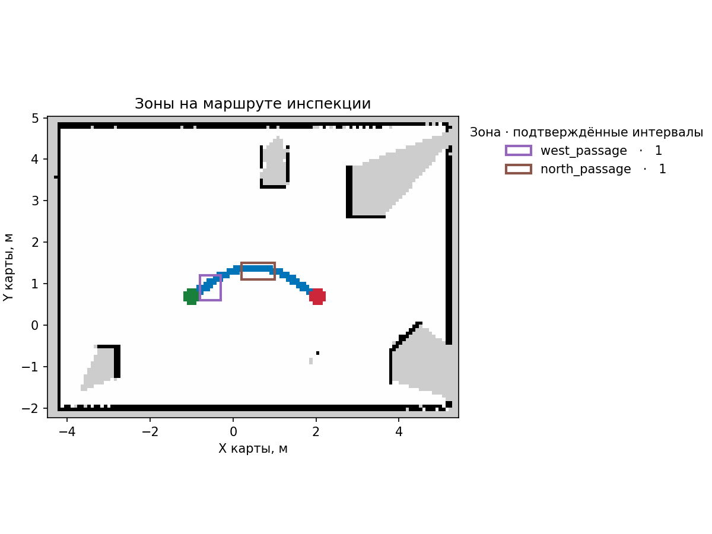

# Посещения зон инспекции

Команда читает траекторию локализации и именованные полигоны. JSON содержит `"frame": "map"` и объект `zones`. Каждому имени соответствует список вершин `[x, y]` простого полигона в метрах системы карты, в порядке обхода. Замыкающее ребро добавляется автоматически. Первую вершину можно повторить один раз в конце. Вогнутые зоны допускаются. Самопересечение, касание несоседних рёбер или повторный проход по ребру вызывают ошибку с именем зоны. Граница входит в зону. Пересекающиеся зоны учитываются по отдельности.

Чтобы получить посещения вместе с картой и траекторией, добавьте к `mgts_nav.solve` два параметра: `--zones configs/demo-zones.json --zone-max-gap 0.25`. Для финальной записи укажите её полигоны и подходящий интервал в секундах. Команда сохраняет копию полигонов в `profiles/zones.json`, отчёт в `inspection/zone-visits.csv`, число интервалов посещения и порог времени в `inspection/summary.json`. Манифест решения включает копию полигонов и отчёт.

```powershell
$python = '.\.venv-mgts\Scripts\python.exe'
& $python -m mgts_nav.zones out/my-first-demo/inspection/trajectory.csv configs/demo-zones.json --max-gap 0.25
```

Для записи в новый CSV добавьте `--out out/zone-visits.csv`. Пример результата в `docs/demo-zone-visits.csv`. На демонстрационной инспекции с частотой 10 Гц робот прошёл западную зону за 13 подтверждённых отсчётов, северную за 21. Обе границы каждого посещения наблюдались. Имена и вершины демонстрационных зон условны.

`--out` сохраняет имена зон в UTF-8 без BOM. При перенаправлении через `>` результат зависит от оболочки. В Windows PowerShell 5.1 при выводе Python в cp1251 и кодировке консоли UTF-8 кириллица исказилась, а файл был записан в UTF-16LE. В PowerShell 7.6.9 перенаправление сохранило байты Python в cp1251. Для передачи отчёта другой программе используйте файл, созданный через `--out`.

Для строки отчёта нужны хотя бы два последовательных отсчёта `matched` внутри зоны с интервалом до `--max-gap` секунд включительно. `first_inside_t` и `last_inside_t` — время первого и последнего такого измерения в секундах. Геометрическое время пересечения между сканами не оценивается. `entry_observed=1` означает, что предыдущая подтверждённая точка с допустимым интервалом была снаружи; `exit_observed=1` означает то же для следующей точки. На границах записи, при разрыве времени или потере статуса обе стороны разрыва оцениваются отдельно. Два фрагмента внутри зоны с неизвестными границами могут принадлежать одному посещению. Короткий проход между измерениями может остаться незамеченным.

В `inspection/summary.json` поле `zones.intervals_by_zone` перечисляет все заданные зоны. Значение 0 означает, что измерений оказалось недостаточно для подтверждения посещения или что оценённая траектория прошла снаружи. Значение 2 может соответствовать двум участкам одного посещения, разделённым потерей привязки. Временные границы каждого участка приведены в `inspection/zone-visits.csv`.

## Точность границ посещения на синтетическом офисе

Расположение зон относительно маршрута можно посмотреть на одной карте. Для результата `solve --zones` запустите `python -m tools.plot_zones out/solution out/zone-map.png` из корня проекта. Сплошной контур означает наличие подтверждённого интервала, пунктирный — его отсутствие. Число рядом с именем зоны берётся из CSV посещений. Зелёная точка отмечает старт, красная — финиш.



При ограничении дальности лидара до 3 м алгоритм по-прежнему сообщил о посещении обеих зон во всех пяти инспекциях. Однако для северной зоны только 54 из 105 действительно проведённых внутри отсчётов попали в отчёт, и ещё 16 отсчётов попали туда ошибочно.

| Обзор при инспекции | Зона | Верно внутри | Ошибочно внутри | Пропущено внутри |
|---|---|---:|---:|---:|
| Полный | Западная | 67 | 0 | 3 |
| Полный | Северная | 105 | 2 | 0 |
| 3 м | Западная | 61 | 2 | 9 |
| 3 м | Северная | 54 | 16 | 51 |

У четырёх из пяти инспекций с дальностью 3 м вход в северную зону отмечен на 0,4 с раньше эталона, а последний отсчёт внутри — на 1,2–1,3 с раньше. На seed 17 это произошло при 100 из 100 принятых сканов. Флаги наблюдения входа и выхода описывают непрерывность оценённой траектории у границы. Они сами по себе не измеряют ошибку положения.

Использованы офисные seeds 17, 101, 202, 303, 404 из [опыта по расхождению движения](motion-disagreement.md). У всех один маршрут и разные реализации шума. Карта каждого обхода построена при полном обзоре, начальная поза инспекции известна. Полигоны взяты из `configs/demo-zones.json`, допустимый интервал равен 0,25 с. Для эталона та же функция выделяет посещения по истинной позе на каждой метке лидара. Счётчики относятся к отсчётам внутри подтверждённых интервалов. Точность на маршруте организаторов пока неизвестна.

Повтор из корня проекта в PowerShell. Первая команда готовит карты и данные в новом каталоге, вторая выводит десять строк JSON с границами интервалов, флагами и счётчиками по зонам.

```powershell
$p = '.\.venv-mgts\Scripts\python.exe'
& $p -m tools.evaluate_motion_disagreement out/zone-office --pr-office
& $p -m tools.evaluate_zone_visits out/zone-office
```
